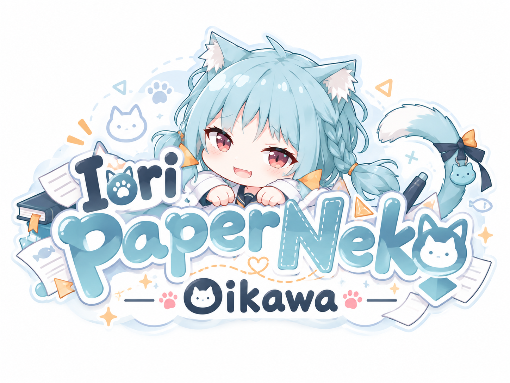

<!-- time-banner:start -->

<!-- time-banner:end -->

  

<table>
  <tr>
    <td width="23%" align="center" valign="middle">
      
    </td>
    <td width="54%" align="center" valign="middle">
      
<strong>Hi there 👋</strong>

      
I’m Iori Oikawa — PaperNeko.

      
Welcome to my little corner of GitHub.

      <!-- Add the full profile introduction here. -->
    </td>
    <td width="23%" align="center" valign="middle">
      
    </td>
  </tr>
</table>

## License

The written content of this README is licensed under
[CC BY 4.0](https://creativecommons.org/licenses/by/4.0/).

Original illustrations, character designs, avatars,
and logos are © Iori Oikawa. All rights reserved.
