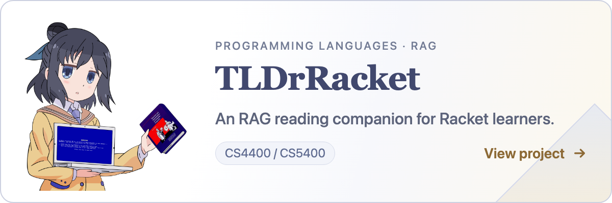
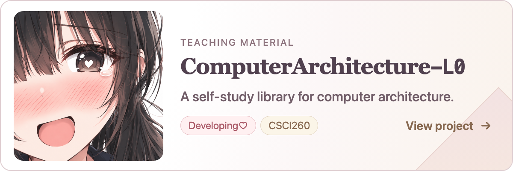
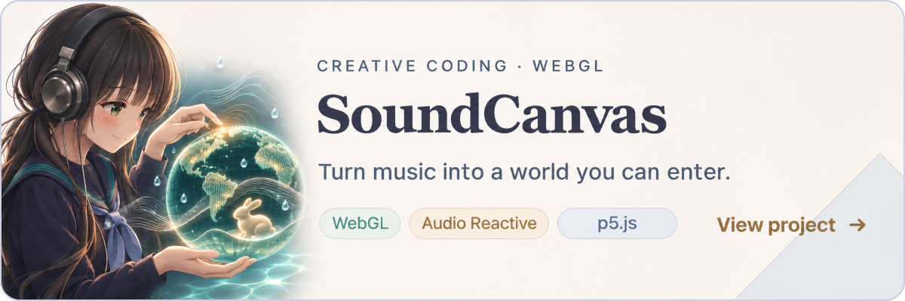
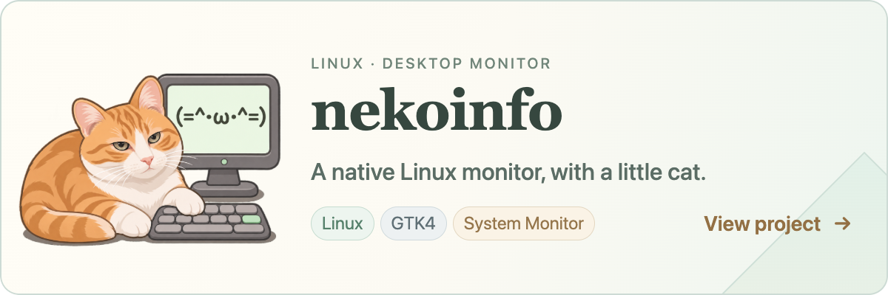

<!-- time-banner:start -->

  <picture>
    <source media="(max-width: 600px) and (prefers-color-scheme: dark)" srcset="https://readme-typing-svg.demolab.com/?font=Fira+Code&amp;size=18&amp;duration=1800&amp;pause=4000&amp;color=A9D5E2&amp;background=00000000&amp;center=true&amp;vCenter=true&amp;multiline=true&amp;repeat=true&amp;groups=5&amp;width=420&amp;height=140&amp;lines=Good+morning%2C+welcome%21%3BAs+a+hacker%2C+a+professor%2C%3Ba+musician%2C+a+kigu...%3BIs+there+anything+I+can+do%3Bto+make+you+code+better%3F">
    <source media="(max-width: 600px)" srcset="https://readme-typing-svg.demolab.com/?font=Fira+Code&amp;size=18&amp;duration=1800&amp;pause=4000&amp;color=476D82&amp;background=00000000&amp;center=true&amp;vCenter=true&amp;multiline=true&amp;repeat=true&amp;groups=5&amp;width=420&amp;height=140&amp;lines=Good+morning%2C+welcome%21%3BAs+a+hacker%2C+a+professor%2C%3Ba+musician%2C+a+kigu...%3BIs+there+anything+I+can+do%3Bto+make+you+code+better%3F">
    <source media="(prefers-color-scheme: dark)" srcset="https://readme-typing-svg.demolab.com/?font=Fira+Code&amp;size=22&amp;duration=2800&amp;pause=4000&amp;color=A9D5E2&amp;background=00000000&amp;center=true&amp;vCenter=true&amp;multiline=true&amp;repeat=true&amp;groups=3&amp;width=900&amp;height=110&amp;lines=Good+morning%2C+welcome%21%3BAs+a+hacker%2C+a+professor%2C+a+musician%2C+a+kigu...%3BIs+there+anything+I+can+do+to+make+you+code+better%3F">
    
  </picture>

<!-- time-banner:end -->

<table>
  <tr>
    <td width="28%" align="center" valign="middle">
      
    </td>
    <td width="44%" align="center" valign="middle">
      
    </td>
    <td width="28%" align="center" valign="middle">
      
    </td>
  </tr>
</table>

## Projects

<a href="https://github.com/IoriOikawa/TLDrRacket">
  <picture>
    <source media="(max-width: 600px)" srcset="assets/projects/tldrracket/banner-mobile.png">
    
  </picture>
</a>

<a href="https://github.com/IoriOikawa/ComputerArchitecture-L0">
  <picture>
    <source media="(max-width: 600px)" srcset="assets/projects/computer-architecture-l0/banner-mobile.png">
    
  </picture>
</a>

<a href="https://github.com/IoriOikawa/SoundCanvas">
  <picture>
    <source media="(max-width: 600px)" srcset="assets/projects/soundcanvas/banner-mobile.png">
    
  </picture>
</a>

<a href="https://github.com/IoriOikawa/nekoinfo">
  <picture>
    <source media="(max-width: 600px)" srcset="assets/projects/nekoinfo/banner-mobile.png">
    
  </picture>
</a>

## License

The written content of this README is licensed under
[CC BY 4.0](https://creativecommons.org/licenses/by/4.0/).

Original illustrations of paperneko-omote is © Iris Amamiya; paperneko-ura's character designs, avatars,
and logos are © Iori Oikawa. All rights reserved.
