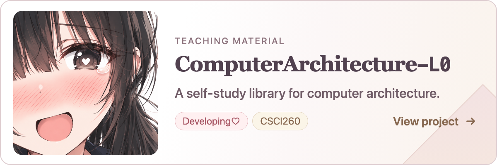

# ComputerArchitecture-L0 项目横幅

横幅已接入个人主页的 Projects 区域，放在 TLDrRacket 之后。
此目录保留独立预览和复用写法。

打开同目录的 `index.html` 查看自动选图：不超过 600 像素使用手机紧凑版，
更宽时使用电脑横版。整张横幅链接到项目仓库。

<a href="https://github.com/IoriOikawa/ComputerArchitecture-L0">
  <picture>
    <source media="(max-width: 600px)" srcset="../../../assets/projects/computer-architecture-l0/banner-mobile.png">
    
  </picture>
</a>

## 设计与内容

- 电脑横版：1200 × 400。
- 手机紧凑版：750 × 450。
- 标题：`ComputerArchitecture-L0`，后缀为大写 L 和数字 0；使用可区分零的等宽字形。窄屏在 Computer 与 Architecture 之间换行。
- 说明：`A self-study library for computer architecture.`
- 电脑横版上方：`TEACHING MATERIAL`。
- 状态气泡：`Developing♡`。
- 课程气泡：`CSCI260`。
- 入口：`View project`。
- 链接：`https://github.com/IoriOikawa/ComputerArchitecture-L0`，不含末尾中文逗号。

说明依据[项目 README](https://github.com/IoriOikawa/ComputerArchitecture-L0#readme)：
项目是面向自学者的课程资料库，而不是已经部署的在线模拟器。

原始人物保存在 `asset_input/computer_architecture_l0_portrait.png`，与提供的图片
内容完全相同。横幅使用圆角肖像窗展示近景；没有重绘人物或移除背景。
可编辑排版及两张 PNG 位于 `assets/projects/computer-architecture-l0/`。
修改排版后需重新导出 PNG；源文件可用 `?layout=desktop` 和 `?layout=mobile`
分别显示固定画布。

## 加入主 README 时的写法

```html
<a href="https://github.com/IoriOikawa/ComputerArchitecture-L0">
  <picture>
    <source media="(max-width: 600px)" srcset="assets/projects/computer-architecture-l0/banner-mobile.png">
    
  </picture>
</a>
```
